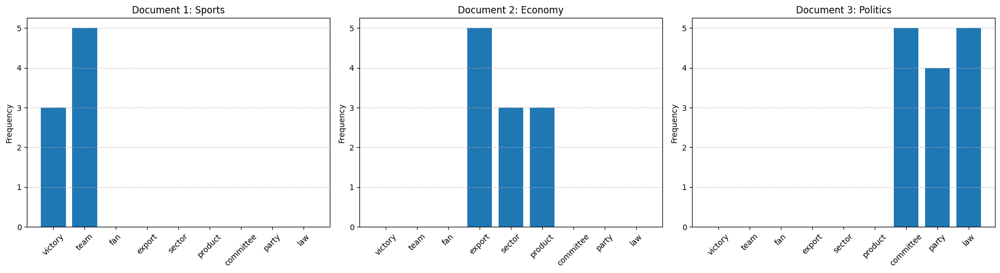

# CENG 463 – HW2: Bag of Words, Text Classification & Topic Modeling

A Jupyter notebook covering three classic NLP techniques, built for the **CENG 463 – Introduction to Machine Learning** course:

1. **Bag of Words**: word-frequency vectors for three short documents (sports, economy, politics).
2. **Text classification**: Chi-square feature selection, TF-IDF weighting and a KNN spam classifier.
3. **Topic modeling**: BERTopic on a 3-category subset of the 20 Newsgroups dataset.

The full assignment description is in [`CENG463_HW2.pdf`](CENG463_HW2.pdf).

## Contents

| File | Description |
| --- | --- |
| `CENG463_HW2_GROUPID.ipynb` | Main notebook with all three tasks and their outputs |
| `sports.txt`, `economy.txt`, `politics.txt` | Input documents for Task 1 |
| `words.txt` | The fixed vocabulary used for the Bag-of-Words vectors |
| `requirements.txt` | Python dependencies |
| `CENG463_HW2.pdf` | Assignment specification |

## Task 1: Bag of Words

Each document is lower-cased and tokenized with a regular expression. The notebook then counts how often each word from a fixed 9-word vocabulary appears:

```
victory, team, fan, export, sector, product, committee, party, law
```

This produces a 3 × 9 frequency matrix, plotted as one bar chart per document:



## Task 2: Text Classification

A small labeled corpus of 5 training documents (spam / not spam) and 2 test documents is used.

1. **Chi-square feature selection**: `CountVectorizer` + `sklearn.feature_selection.chi2` rank the words by how well they separate the classes. The top 3 discriminative words are:

   | Word | χ² |
   | --- | --- |
   | free | 9.0 |
   | smile | 4.5 |
   | discount | 3.0 |

2. **TF-IDF representation**: `TfidfVectorizer` restricted to those 3 words.
3. **KNN classification** (`k = 3`) on the TF-IDF vectors:

   | Test document | Prediction |
   | --- | --- |
   | `dog cat mouse cat` | not spam |
   | `free free smile` | spam |

## Task 3: Topic Modeling with BERTopic

- **Data:** 20 Newsgroups (`alt.atheism`, `rec.autos`, `talk.politics.mideast`), with headers, footers and quotes removed.
- **Model:** BERTopic with UMAP (`n_neighbors=15`, `n_components=5`), HDBSCAN (`min_cluster_size=10`) and an English stop-word `CountVectorizer`.
- **Analysis:** the notebook finds 17 topics. Each topic gets a human-readable label (Autos / MiddleEast / Atheism) based on the majority newsgroup of its documents, and the notebook prints the top words per topic, a document–topic table, a bar chart and a topic distance map.
- **New documents:** three unseen documents (about religion, a V8 engine and Middle East diplomacy) are all assigned to the correct category.

## Getting Started

```bash
python -m venv venv
source venv/bin/activate        # Windows: venv\Scripts\activate
pip install -r requirements.txt
jupyter notebook CENG463_HW2_GROUPID.ipynb
```

Run the notebook from the repository root so the `.txt` input files are found. The 20 Newsgroups dataset downloads automatically the first time you run Task 3.

## Tech Stack

Python · NumPy · pandas · Matplotlib · scikit-learn · BERTopic (UMAP + HDBSCAN) · Jupyter
